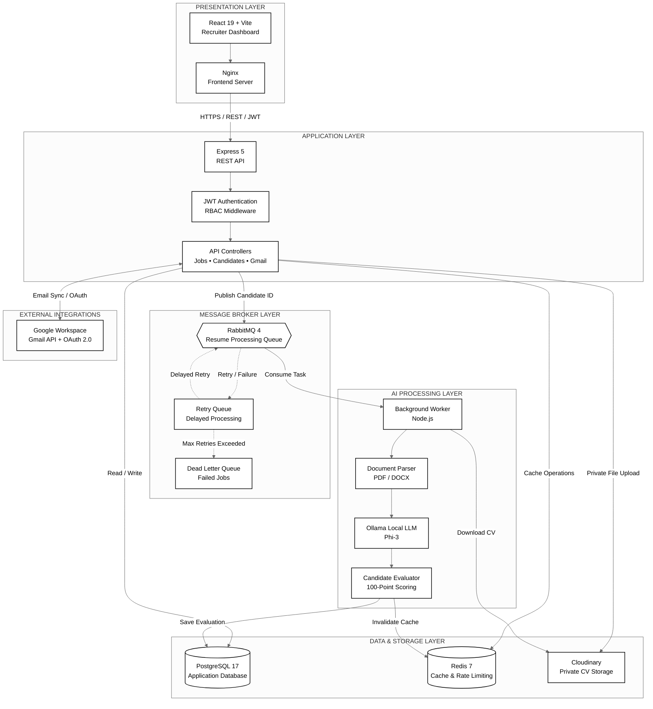
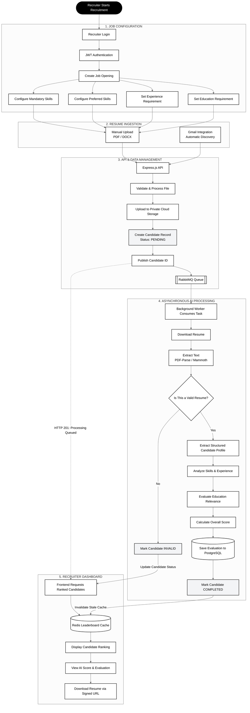
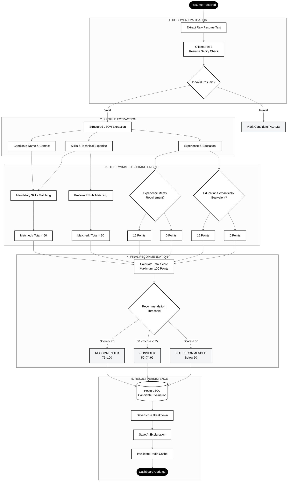
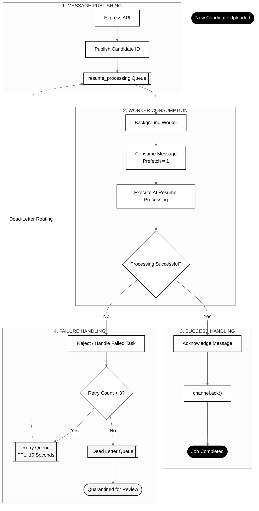
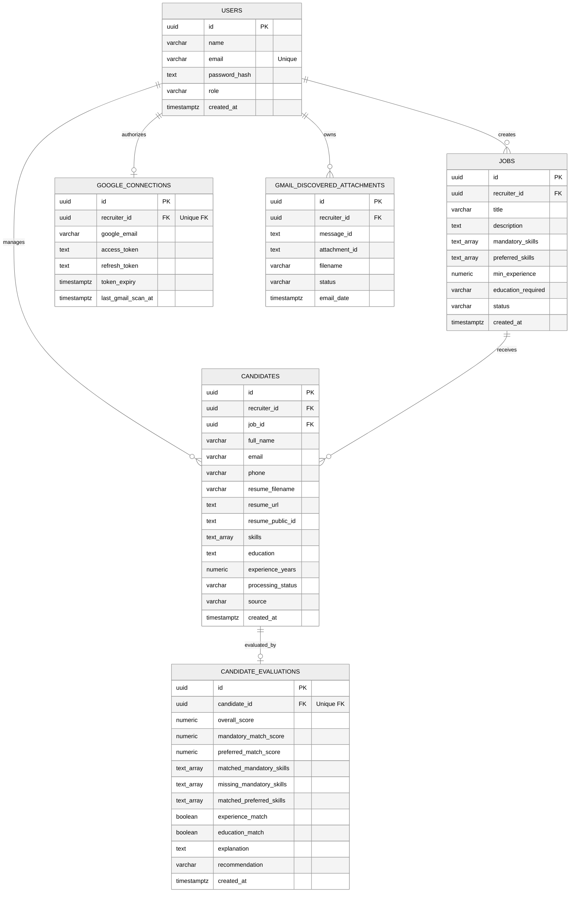

🤖 RecruitAI — Intelligent Automated Recruitment & CV Screening System

<strong>AI-Powered Recruitment | Automated CV Screening | Asynchronous Processing</strong>

RecruitAI is an enterprise-oriented, asynchronous AI recruitment platform that automates resume parsing, candidate analysis, and job-specific scoring. Powered by a distributed background worker architecture, RabbitMQ, PostgreSQL, Redis, and a local privacy-focused LLM (Ollama phi3), it transforms traditional manual CV screening into an efficient automated workflow.
📑 Table of Contents
System Architecture
End-to-End System Process Flow
AI Screening & Evaluation Decision Flow
Gmail Automated Sync & Import Flow
RabbitMQ Resilient Queue Architecture
Database Schema & ER Diagram
Deterministic Scoring Algorithm
Tech Stack
Project Directory Structure
Environment Configuration
Getting Started & Installation
API Reference
Security & Compliance
🏛 System Architecture

RecruitAI follows a Distributed Asynchronous Message Queue Architecture.

The Express API handles authentication, job management, candidate uploads, and recruiter requests. Computationally intensive AI processing is delegated to independent background workers through RabbitMQ.

This separation improves API responsiveness, processing reliability, and scalability.

High-Level Architecture

Architecture Highlights
Component	Responsibility
React + Nginx	Responsive recruiter dashboard
Express API	REST endpoints and business logic
PostgreSQL	Persistent application and evaluation data
Redis	Leaderboard caching and rate limiting
Cloudinary	Private resume document storage
RabbitMQ	Asynchronous job distribution
Background Worker	Resume extraction and AI evaluation
Ollama Phi-3	Local AI-powered document analysis
Gmail API	Automated resume discovery and import
🔄 End-to-End System Process Flow

This diagram illustrates the complete recruitment lifecycle, from job creation to candidate ranking.

Processing Lifecycle
Recruiter creates a job and defines evaluation requirements.
Candidates enter through manual uploads or Gmail integration.
The API securely stores documents and candidate metadata.
RabbitMQ distributes processing tasks to background workers.
Workers extract resume content and perform AI analysis.
The scoring engine calculates the candidate's overall score.
Evaluation results are persisted in PostgreSQL.
Redis cache is invalidated so the dashboard can retrieve updated rankings.
🧠 AI Screening & Evaluation Decision Flow

RecruitAI uses a hybrid evaluation model combining deterministic mathematical scoring and LLM-assisted semantic analysis.

Scoring Breakdown
Evaluation Criteria	Weight	Calculation
Mandatory Skills	50%	Matched mandatory skills / total mandatory skills × 50
Preferred Skills	20%	Matched preferred skills / total preferred skills × 20
Experience	15%	15 points if requirement is satisfied
Education	15%	15 points if degree is considered equivalent
Total	100%	Sum of all evaluation components
Recommendation Levels
Score	Recommendation	Description
75–100	🟢 RECOMMENDED	Strong alignment with job requirements
50–74.99	🟡 CONSIDER	Partial alignment with job requirements
Below 50	🔴 NOT RECOMMENDED	Lower alignment with job requirements
Note: Automated scores should support recruiter decisions, not replace human judgment. Candidates should be assessed using job-related criteria, with appropriate review of AI-generated extraction and recommendations.
✉️ Gmail Automated Sync & Import Flow

RecruitAI integrates with Google Workspace through OAuth 2.0 and the Gmail API to discover resume attachments automatically.

```mermaid
%%{init: {'theme': 'neutral'}}%%
flowchart TB

    START(["Node-Cron Scheduler<br/>Every 5 Minutes"])

    subgraph AUTH["1. GOOGLE AUTHENTICATION"]
        A["Fetch Connected Recruiters"]
        B["Load Google OAuth Tokens"]
        C{"Access Token Expired?"}
        D["Refresh OAuth Access Token"]
        E["Update Token in PostgreSQL"]

        A --> B --> C
        C -->|"Yes"| D --> E
        C -->|"No"| F["Continue"]
        E --> F
    end

    subgraph DISCOVERY["2. EMAIL DISCOVERY"]
        G["Gmail API: List Messages"]
        H["Search Emails with Attachments"]
        I["Inspect Subject & Email Content"]
        J{"Contains Resume Keywords?"}
        K["Inspect PDF / DOCX Attachments"]
        L["Skip Irrelevant Email"]

        G --> H --> I --> J
        J -->|"Yes"| K
        J -->|"No"| L
    end

    subgraph DEDUP["3. DUPLICATE DETECTION"]
        M{"Attachment Already Recorded?"}
        N["Skip Existing Attachment"]
        O["Save New Attachment Metadata"]
        P[("PostgreSQL<br/>Discovered Attachments")]

        M -->|"Yes"| N
        M -->|"No"| O --> P
    end

    subgraph IMPORT["4. RECRUITER IMPORT"]
        Q["Display Attachment in Dashboard"]
        R["Recruiter Selects Target Job"]
        S["Click Import"]
        T["Download Attachment from Gmail"]
        U["Upload to Private Cloudinary Storage"]
        V["Create Candidate Record"]
        W["Mark Attachment as Imported"]

        Q --> R --> S --> T --> U --> V --> W
    end

    subgraph PROCESS["5. AI PROCESSING"]
        X["Publish Candidate ID to RabbitMQ"]
        Y["Background Worker Consumes Task"]
        Z["AI Resume Evaluation"]
        END(["Candidate Appears in Ranked Dashboard"])

        X --> Y --> Z --> END
    end

    START --> A
    F --> G
    K --> M
    P --> Q
    W --> X

    %% B&W STYLING
    classDef default fill:#FFFFFF,stroke:#000000,stroke-width:1.5px,color:#000000;
    classDef dark fill:#000000,stroke:#000000,stroke-width:1.5px,color:#FFFFFF;
    classDef gray fill:#F3F4F6,stroke:#000000,stroke-width:1.5px,color:#000000;

    class START,END dark;
    class L,N gray;
```

Gmail Integration Features
Google OAuth 2.0 authentication.
Automated background inbox scanning.
Resume attachment discovery.
PDF and DOCX attachment filtering.
Duplicate attachment detection.
Recruiter-controlled candidate import.
Automatic RabbitMQ processing after import.
📬 RabbitMQ Resilient Queue Architecture

RabbitMQ handles asynchronous communication between the Express API and background workers.

The retry mechanism and Dead Letter Queue (DLQ) isolate failed messages and prevent unlimited processing attempts.

Queue Reliability Features
Feature	Purpose
Message Acknowledgment	Confirms successful processing
Prefetch = 1	Controls concurrent message delivery per consumer
Retry Queue	Delays failed task retries
Message TTL	Controls retry delay
Dead Letter Queue	Stores messages that exceed retry limits
Channel Confirm	Helps verify message publishing
🗄️ Database Schema & ER Diagram

The following entity relationship diagram illustrates the core PostgreSQL database structure.

🎯 Deterministic Scoring Algorithm

RecruitAI uses a hybrid evaluation approach:

Deterministic scoring: Skills matching and experience calculations.
Semantic AI evaluation: Education equivalence using Ollama Phi-3.
Overall Scoring Formula
Overall Score
=
𝑀
+
𝑃
+
𝐸
+
𝐷

Where:

𝑀
=
Matched Mandatory Skills
Total Mandatory Skills
×
50
𝑃
=
Matched Preferred Skills
Total Preferred Skills
×
20
𝐸
=
{
15
	
if experience requirement is satisfied

0
	
otherwise
𝐷
=
{
15
	
if education requirement is satisfied

0
	
otherwise
Section	Weight	Evaluation Logic
Mandatory Skills	50%	Case-normalized strict set intersection
Preferred Skills	20%	Matching preferred capabilities
Experience	15%	Candidate experience compared with job requirement
Education	15%	AI-assisted semantic degree equivalence
Total	100%	Combined evaluation score
Automated Recommendation Tiers
🟢 75–100 — RECOMMENDED: Strong alignment with job requirements.
🟡 50–74.99 — CONSIDER: Partial alignment with job requirements.
🔴 Below 50 — NOT RECOMMENDED: Lower alignment with job requirements.
Implementation note: If a job has no mandatory or preferred skills, the corresponding scoring component should have an explicitly defined fallback to avoid division by zero.
💻 Tech Stack
Domain	Technology	Description
Frontend	React 19, Vite, Tailwind CSS, Lucide Icons, Recharts	Responsive recruiter dashboard
State Management	Zustand	Lightweight authentication and session state
Backend API	Node.js, Express 5	REST API and business logic
Database	PostgreSQL 17	Relational database with UUIDs and arrays
Message Queue	RabbitMQ 4	Asynchronous task distribution
Caching	Redis 7	Leaderboard caching and rate limiting
AI / LLM	Ollama (phi3:latest)	Local AI-powered resume analysis
File Parsing	pdf-parse, mammoth	PDF and DOCX text extraction
Storage	Cloudinary	Private authenticated document storage
Email Sync	Google APIs, node-cron	OAuth-based Gmail integration
Containerization	Docker, Docker Compose, Nginx	Application containerization
📂 Project Directory Structure
text
ai-recruitment-system/
│
├── backend/
│   └── server/
│       ├── config/
│       │   └── Database, RabbitMQ & Cloudinary clients
│       │
│       ├── controllers/
│       │   └── Auth, Jobs, Candidates & Gmail controllers
│       │
│       ├── lib/
│       │   └── Environment configuration & Redis client
│       │
│       ├── middlewares/
│       │   └── JWT, RBAC, Multer, Rate Limiter & Error Handler
│       │
│       ├── routes/
│       │   └── REST API endpoints
│       │
│       ├── services/
│       │   └── Cloudinary, Gmail Scheduler & Google OAuth
│       │
│       ├── Dockerfile
│       └── package.json
│
├── db/
│   └── init.sql
│
├── frontend/
│   ├── src/
│   │   ├── api/
│   │   │   └── Axios API client
│   │   │
│   │   ├── components/
│   │   │   └── TopNav, Sidebar, Cards & Route Guards
│   │   │
│   │   ├── pages/
│   │   │   └── Dashboard, Candidates, Jobs & CV Screening
│   │   │
│   │   ├── store/
│   │   │   └── Zustand authentication store
│   │   │
│   │   ├── App.jsx
│   │   └── routes.jsx
│   │
│   ├── nginx.conf
│   ├── Dockerfile
│   └── package.json
│
├── workers/
│   ├── src/
│   │   ├── consumers/
│   │   │   └── RabbitMQ consumer
│   │   │
│   │   ├── services/
│   │   │   └── Ollama, CV Extractor & Candidate Evaluator
│   │   │
│   │   └── worker.js
│   │
│   ├── Dockerfile
│   └── package.json
│
├── docker-compose.yml
├── .env
└── README.md

⚙️ Environment Configuration
Backend (backend/server/.env)
ini
PORT=4000
NODE_ENV=production
CORS_ORIGIN=http://localhost:5173

DB_HOST=postgres
DB_PORT=5432
DB_NAME=recruitment_db
DB_USER=recruitment_user
DB_PASSWORD=your_postgres_password

JWT_SECRET=your_super_secret_jwt_key_here

CLOUDINARY_CLOUD_NAME=your_cloud_name
CLOUDINARY_API_KEY=your_api_key
CLOUDINARY_API_SECRET=your_api_secret

RABBITMQ_HOST=rabbitmq
RABBITMQ_PORT=5672
RABBITMQ_USER=recruitment_user
RABBITMQ_PASSWORD=your_rabbitmq_password

REDIS_HOST=redis
REDIS_PORT=6379
REDIS_URL=redis://redis:6379

GOOGLE_CLIENT_ID=your_google_client_id.apps.googleusercontent.com
GOOGLE_CLIENT_SECRET=your_google_client_secret
GOOGLE_REDIRECT_URI=http://localhost:4000/api/gmail/callback
FRONTEND_URL=http://localhost:5173

Worker (workers/.env)
ini
NODE_ENV=production

DB_HOST=postgres
DB_PORT=5432
DB_NAME=recruitment_db
DB_USER=recruitment_user
DB_PASSWORD=your_postgres_password

RABBITMQ_HOST=rabbitmq
RABBITMQ_PORT=5672
RABBITMQ_USER=recruitment_user
RABBITMQ_PASSWORD=your_rabbitmq_password

CLOUDINARY_CLOUD_NAME=your_cloud_name
CLOUDINARY_API_KEY=your_api_key
CLOUDINARY_API_SECRET=your_api_secret

OLLAMA_BASE_URL=http://host.docker.internal:11434

REDIS_HOST=redis
REDIS_URL=redis://redis:6379

Security: Never commit actual .env files, API keys, passwords, OAuth secrets, or JWT secrets to GitHub. Use an .env.example file containing placeholders.
🚀 Getting Started & Installation
1. Prerequisites

Install the following tools:

Docker Desktop with Docker Compose v2.
Ollama installed and running locally.
Git.

Download the required AI model:

bash
ollama pull phi3:latest

Verify Ollama is running:

bash
ollama list

2. Clone the Repository
bash
git clone YOUR_REPOSITORY_URL
cd ai-recruitment-system

3. Configure Environment Variables

Create and configure the required environment files:

backend/server/.env
workers/.env
Root .env if required by Docker Compose.

Add your PostgreSQL, RabbitMQ, Cloudinary, Google OAuth, and JWT credentials.

4. Launch with Docker Compose
bash
docker compose up -d --build

Check running containers:

bash
docker compose ps

View application logs:

bash
docker compose logs -f

5. Service Endpoints
Service	URL	Description
Frontend	http://localhost:5173	React Recruiter Dashboard
Backend API	http://localhost:4000	Express REST API
Adminer	http://localhost:8080	PostgreSQL Management
RabbitMQ	http://localhost:15672	Queue Management Dashboard
Redis	localhost:6379	Cache Service

RabbitMQ Management Credentials

Username: recruitment_user
Password: Your configured RabbitMQ password.

Adminer Credentials

System: PostgreSQL
Server: postgres
Username: recruitment_user
Password: Your configured database password.
📡 API Reference
Authentication — /api/auth
Method	Endpoint	Description
POST	/api/auth/signup	Register recruiter
POST	/api/auth/login	Authenticate and receive JWT
GET	/api/auth/me	Retrieve authenticated user profile
Jobs Management — /api/jobs
Method	Endpoint	Description
GET	/api/jobs	List recruiter's job openings
POST	/api/jobs	Create a new job
GET	/api/jobs/:id	Retrieve job details
PUT	/api/jobs/:id	Update job requirements
DELETE	/api/jobs/:id	Delete a job opening
Candidates & Screening — /api/candidates
Method	Endpoint	Description
POST	/api/candidates/upload	Upload PDF/DOCX resume
GET	/api/candidates	List candidates
GET	/api/candidates/jobs/:jobId/ranked	Retrieve ranked candidates
GET	/api/candidates/:candidateId/resume	Generate temporary resume download URL
DELETE	/api/candidates/:candidateId	Delete candidate
Gmail Integration — /api/gmail
Method	Endpoint	Description
GET	/api/gmail/connect	Generate Google OAuth consent URL
GET	/api/gmail/callback	Handle OAuth callback
GET	/api/gmail/status	Check Gmail connection
GET	/api/gmail/scan	Trigger inbox scan
GET	/api/gmail/discovered	Retrieve discovered attachments
POST	/api/gmail/import	Import email attachment into a job
🔒 Security & Compliance

RecruitAI incorporates multiple security mechanisms to protect recruiter accounts, candidate information, and uploaded documents.

1. Privacy-First AI Processing
Resume analysis is performed using a locally hosted Ollama model.
Candidate resume content is not intentionally sent to external AI inference APIs.
Local inference reduces dependency on third-party AI processing services.
2. Secure Resume Storage
Resumes are stored using Cloudinary authenticated assets.
Public document access is restricted.
Temporary signed download URLs are generated through the backend.
Recruiter ownership is verified before generating download access.
3. Authentication & Authorization
JWT-based authentication.
Role-based access control middleware.
Password hashing using bcryptjs.
Protected API endpoints.
4. OWASP Security Practices
Security Mechanism	Implementation
SQL Injection Prevention	Parameterized queries using pg.Pool
Password Security	bcryptjs with 12 salt rounds
Authentication	JWT Bearer tokens
Authorization	RBAC middleware
HTTP Security	Helmet
CORS	Origin whitelisting
Rate Limiting	rate-limiter-flexible
File Upload Security	Multer and file validation
Document Access	Authenticated storage and signed URLs
5. Data Protection Recommendations
Encrypt sensitive OAuth tokens at rest.
Use HTTPS in production.
Rotate application secrets periodically.
Restrict access to database and message broker ports.
Configure backups and retention policies.
Audit candidate access and recruiter actions.
Validate AI-extracted information before using it in hiring decisions.
Apply consistent, job-related evaluation criteria and provide human review.
🌟 Key Features
Feature	Description
🤖 AI Resume Screening	Automated resume validation and extraction
📊 Intelligent Candidate Ranking	Job-specific candidate scoring
⚡ Asynchronous Processing	RabbitMQ-powered background workers
📩 Gmail Integration	Automated email attachment discovery
🔐 Secure Document Storage	Authenticated Cloudinary assets
🧠 Local LLM Processing	Privacy-focused Ollama integration
📈 Live Leaderboard	Redis-cached candidate rankings
🐳 Docker Deployment	Multi-service container orchestration
🎯 Hybrid Evaluation	Deterministic scoring and semantic analysis

<strong>🤖 RecruitAI — Making Recruitment Smarter, Faster & More Efficient.</strong>

Built with ❤️ using React, Node.js, PostgreSQL, RabbitMQ, Redis & Ollama.

