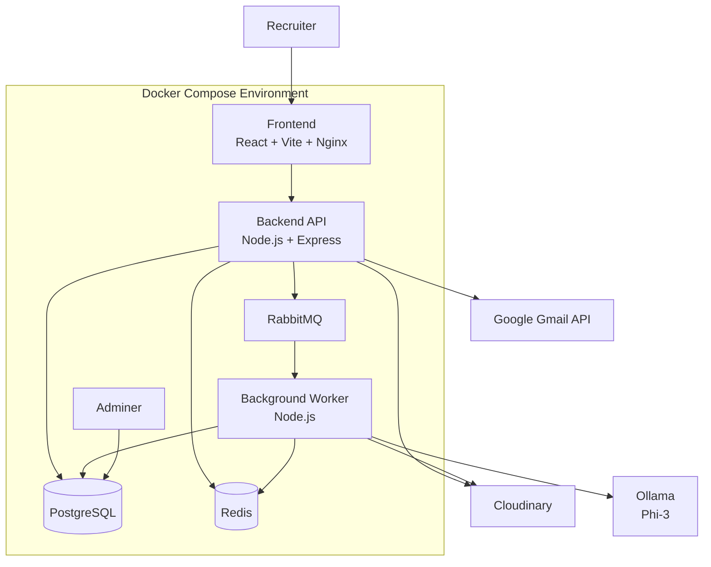
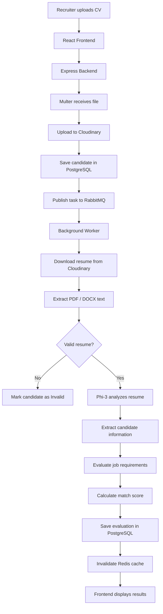
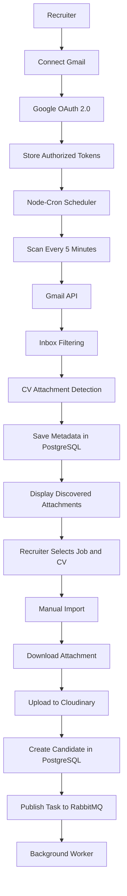
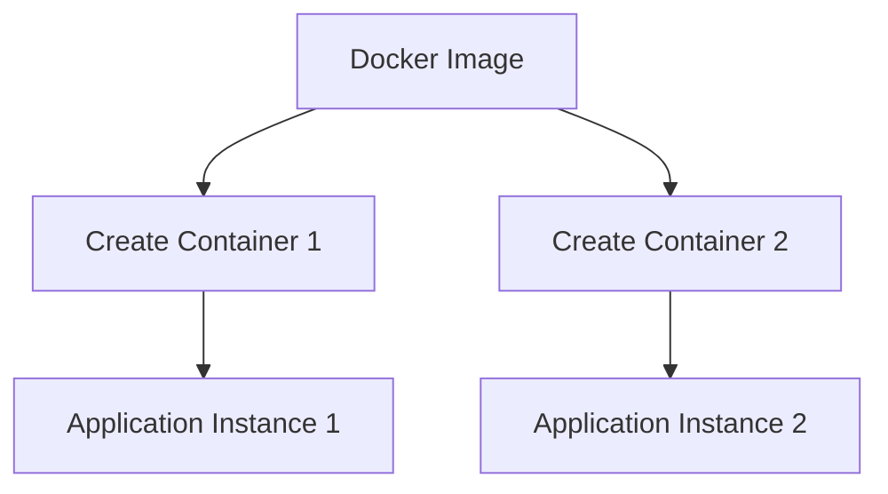
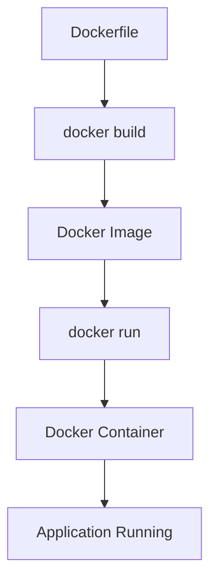
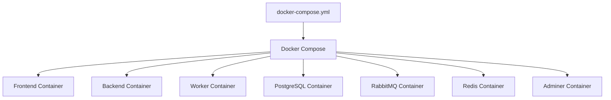
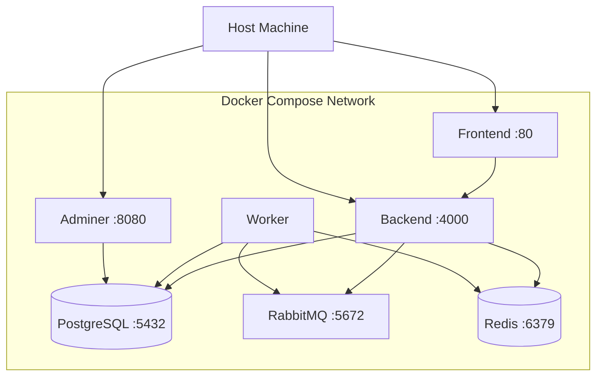

# RecruitAI – AI-Powered CV Screening and Recruitment Management System

An intelligent recruitment platform that automates resume screening, candidate evaluation, and recruitment management using Artificial Intelligence.

RecruitAI combines deterministic scoring algorithms with semantic AI evaluation to help recruiters identify and rank suitable candidates against specific job requirements.

---

## Table of Contents

1. [Overview](#1-overview)
2. [Key Features](#2-key-features)
3. [Technology Stack](#3-technology-stack)
4. [System Architecture](#4-system-architecture)
5. [Resume Processing Workflow](#5-resume-processing-workflow)
6. [Hybrid Candidate Evaluation](#6-hybrid-candidate-evaluation)
7. [Gmail Integration](#7-gmail-integration)
8. [Docker Architecture](#8-docker-architecture)
9. [Project Structure](#9-project-structure)
10. [Environment Configuration](#10-environment-configuration)
11. [Installation and Setup](#11-installation-and-setup)
12. [Service Endpoints](#12-service-endpoints)
13. [API Reference](#13-api-reference)
14. [Security](#14-security)
15. [Docker Commands](#15-docker-commands)

---

## 1. Overview

RecruitAI streamlines the recruitment process by allowing recruiters to:

- Create job openings and define hiring requirements.
- Upload multiple candidate resumes.
- Automatically extract candidate information.
- Evaluate candidates against job-specific criteria.
- Generate explainable match scores.
- Rank candidates based on their qualifications.
- Discover potential CV attachments from Gmail.
- Import selected email attachments for screening.

The application uses a containerized architecture with asynchronous background processing to keep resume analysis separate from normal API requests.

---

## 2. Key Features

| Feature | Description |
|---|---|
| Recruiter Authentication | JWT-based registration and login |
| Job Management | Create, update, and delete job openings |
| CV Upload | Upload PDF and DOCX resumes |
| Resume Extraction | Extract text using PDF and DOCX parsers |
| AI Resume Analysis | Extract candidate information using Phi-3 |
| Resume Validation | Identify invalid or unrelated documents |
| Candidate Evaluation | Evaluate skills, experience, and education |
| Candidate Ranking | Rank candidates based on match scores |
| Explainable Results | Display matched skills, missing skills, and explanations |
| Background Processing | Process resumes asynchronously using RabbitMQ |
| Retry Mechanism | Retry failed processing tasks |
| Dead Letter Queue | Store repeatedly failed tasks |
| Gmail Integration | Discover potential CV attachments |
| Scheduled Scanning | Scan connected Gmail inboxes every five minutes |
| Cloud Storage | Store resumes securely using Cloudinary |
| Redis Caching | Cache ranked candidate results |
| Docker Deployment | Run application services using Docker Compose |

---

## 3. Technology Stack

| Domain | Technology | Description |
|---|---|---|
| Frontend | React 19, Vite | Recruiter dashboard and user interface |
| Styling | Tailwind CSS | Responsive application styling |
| Icons | Lucide Icons | Interface icons |
| Charts | Recharts | Dashboard analytics and visualizations |
| State Management | Zustand | Authentication and session state |
| HTTP Client | Axios | Frontend API communication |
| Backend | Node.js, Express 5 | REST API and business logic |
| Database | PostgreSQL 17 | Relational database with UUIDs and arrays |
| Message Queue | RabbitMQ 4 | Asynchronous task distribution |
| Caching | Redis 7 | Candidate ranking cache and rate limiting |
| AI / LLM | Ollama (phi3:latest) | Local AI-powered resume analysis |
| PDF Parsing | pdf-parse | PDF text extraction |
| DOCX Parsing | Mammoth | DOCX text extraction |
| File Upload | Multer | Handling incoming file uploads |
| Cloud Storage | Cloudinary | Authenticated resume storage |
| Email Integration | Google APIs | Gmail OAuth and attachment discovery |
| Scheduler | node-cron | Periodic Gmail scanning |
| Containerization | Docker | Application containerization |
| Orchestration | Docker Compose | Multi-container management |
| Web Server | Nginx | Production frontend serving |
| Database Management | Adminer | PostgreSQL administration |

---

## 4. System Architecture

RecruitAI consists of three main application components and supporting infrastructure services.

### Application Components

**Frontend**
- React and Vite.
- Served through Nginx.
- Communicates with the backend through REST APIs.

**Backend API**
- Node.js and Express.
- Handles authentication, job management, candidate management, and file uploads.
- Communicates with PostgreSQL, Redis, RabbitMQ, Cloudinary, and Gmail APIs.

**Background Worker**
- Node.js and Ollama (Phi-3).
- Consumes resume-processing tasks from RabbitMQ.
- Extracts and analyzes candidate resumes independently of API requests.

### Infrastructure Services

- PostgreSQL – Persistent application data.
- RabbitMQ – Asynchronous task distribution.
- Redis – Caching and performance.
- Adminer – Database management.

### External Services

- Cloudinary – Resume file storage.
- Google Gmail API – Email and attachment discovery.
- Ollama – Phi-3 model inference.

### Architecture Diagram



**Note:** Cloudinary, Google Gmail API, and Ollama are external to the Docker Compose services in this setup. Ollama runs on the host machine and is accessed by the worker through `host.docker.internal`.

---

## 5. Resume Processing Workflow

Resume processing is performed asynchronously using RabbitMQ and a dedicated background worker.

### Processing Steps

1. Recruiter uploads a resume through the frontend.
2. Frontend sends the file using `FormData`.
3. Express receives the upload request.
4. Multer handles the incoming file.
5. Backend uploads the resume to Cloudinary.
6. Candidate information and resume metadata are stored in PostgreSQL.
7. Backend publishes a processing task to RabbitMQ.
8. Background worker consumes the task.
9. Worker downloads the resume from Cloudinary.
10. PDF or DOCX text is extracted.
11. Phi-3 validates the uploaded document.
12. Phi-3 analyzes the resume and extracts candidate information.
13. Evaluation service compares the candidate with job requirements.
14. Match score and evaluation explanation are generated.
15. Results are stored in PostgreSQL.
16. Redis cache is invalidated for the affected job.
17. Frontend displays the updated candidate information.

### Resume Processing Diagram



---

## 6. Hybrid Candidate Evaluation

RecruitAI uses a hybrid evaluation approach combining deterministic scoring and semantic AI evaluation.

### 6.1 Deterministic Scoring

The following criteria are evaluated using application logic rather than relying on AI-generated scores:

- Mandatory skills matching.
- Preferred skills matching.
- Experience requirement comparison.

Skills matching uses case-normalized strict set intersection.

### 6.2 Semantic AI Evaluation

Education equivalence is evaluated using Ollama Phi-3.

For example:

- Job requirement: BS Computer Science.
- Candidate education: BS Artificial Intelligence.

The AI evaluates whether the candidate's degree is semantically related to the required qualification.

The final education component is determined by whether the requirement is satisfied.

### 6.3 Scoring Weights

| Evaluation Criteria | Weight | Evaluation Logic |
|---|---:|---|
| Mandatory Skills | 50% | Case-normalized strict set intersection |
| Preferred Skills | 20% | Matching preferred capabilities |
| Experience | 15% | Candidate experience compared with job requirement |
| Education | 15% | AI-assisted semantic degree equivalence |
| **Total** | **100%** | **Combined evaluation score** |

### 6.4 Scoring Formula

The overall score is calculated using four components:

**Mandatory Skills (M)**

\[
M = \frac{\text{Matched Mandatory Skills}}{\text{Total Mandatory Skills}} \times 50
\]

**Preferred Skills (P)**

\[
P = \frac{\text{Matched Preferred Skills}}{\text{Total Preferred Skills}} \times 20
\]

**Experience (E)**

\[
E =
\begin{cases}
15 & \text{if experience requirement is satisfied} \\
0 & \text{otherwise}
\end{cases}
\]

**Education (D)**

\[
D =
\begin{cases}
15 & \text{if education requirement is satisfied} \\
0 & \text{otherwise}
\end{cases}
\]

**Overall Score**

\[
\boxed{\text{Overall Score} = M + P + E + D}
\]

### 6.5 Example Calculation

Suppose a candidate has:

| Criterion | Result | Score |
|---|---|---:|
| Mandatory Skills | 4 out of 5 matched | 40 |
| Preferred Skills | 3 out of 4 matched | 15 |
| Experience | Requirement satisfied | 15 |
| Education | Requirement satisfied | 15 |
| **Overall Score** | | **85%** |

### 6.6 Empty Skills Fallback

To avoid division by zero:

- If a job has no mandatory skills, the mandatory component should use an explicitly defined fallback.
- If a job has no preferred skills, the preferred component should use an explicitly defined fallback.

The fallback should be implemented consistently in the scoring service.

### 6.7 Automated Recommendation Tiers

| Score Range | Recommendation | Meaning |
|---|---|---|
| 75–100 | RECOMMENDED | Strong alignment with job requirements |
| 50–74.99 | CONSIDER | Partial alignment with job requirements |
| Below 50 | NOT RECOMMENDED | Lower alignment with job requirements |

---

## 7. Gmail Integration

RecruitAI integrates Gmail using Google OAuth 2.0.

### Features

- Connect and disconnect Gmail accounts.
- Secure OAuth state validation.
- Scan authorized inboxes.
- Detect potential CV attachments.
- Filter emails and attachments using keywords.
- Store discovered attachment metadata in PostgreSQL.
- Schedule scans every five minutes.
- Allow recruiters to manually select a job and import CVs.
- Prevent duplicate imports.

### Gmail Workflow

1. Recruiter connects their Gmail account.
2. Google authenticates the recruiter and grants the requested permissions.
3. Backend stores the authorized connection.
4. Node-Cron scheduler runs every five minutes.
5. Gmail API scans the inbox.
6. Potential CV attachments are identified.
7. Attachment metadata is stored in PostgreSQL.
8. Recruiter views discovered attachments.
9. Recruiter selects a job and clicks Import.
10. Backend downloads the attachment from Gmail.
11. Resume is uploaded to Cloudinary.
12. Candidate record is created.
13. Backend publishes a task to RabbitMQ.
14. Existing worker processes the resume.

**Important:** The scheduler only discovers potential CV attachments. It does not download or import files automatically. The recruiter manually selects the job and imports the attachment.

### Gmail Integration Diagram



---

## 8. Docker Architecture

### 8.1 What is Docker?

Docker is a platform used to package applications and their dependencies into isolated environments called containers.

It allows applications to run consistently across different environments.

### 8.2 Docker Image

A Docker image is a read-only template used to create containers.

It contains the application code, dependencies, runtime environment, and instructions required to start an application.

### 8.3 Docker Container

A Docker container is a running instance of a Docker image.

Each container provides an isolated environment in which an application or service runs.

### 8.4 Image vs Container

| Docker Image | Docker Container |
|---|---|
| Template or package | Instance of an image |
| Read-only | Has a writable runtime layer |
| Used to create containers | Runs the application |
| Can create multiple containers | Executes independently |

### Image and Container Diagram



### 8.5 Dockerfile

A Dockerfile contains instructions for building a Docker image.

Example:

```dockerfile
FROM node:24-alpine

WORKDIR /app

COPY package*.json ./

RUN npm ci

COPY . .

EXPOSE 4000

CMD ["npm", "start"]
```

| Instruction | Purpose |
|---|---|
| FROM | Selects the base image |
| WORKDIR | Sets the working directory |
| COPY | Copies files into the image |
| RUN | Executes commands during image building |
| EXPOSE | Documents the application port |
| CMD | Defines the default startup command |

### Dockerfile Build Process



### 8.6 Docker Compose

Docker Compose defines and manages multiple services through a single YAML configuration file.

Our `docker-compose.yml` defines seven services:

1. Frontend.
2. Backend.
3. Worker.
4. PostgreSQL.
5. RabbitMQ.
6. Redis.
7. Adminer.

### Docker Compose Diagram



### 8.7 Images and Containers in RecruitAI

| Service | Image | Container |
|---|---|---|
| Frontend | Custom frontend image | recruitment-frontend |
| Backend | Custom backend image | recruitment-backend |
| Worker | Custom worker image | recruitment-worker |
| PostgreSQL | postgres:17-alpine | recruitment-postgres |
| RabbitMQ | rabbitmq:4-management-alpine | recruitment-rabbitmq |
| Redis | redis:7-alpine | recruitment-redis |
| Adminer | adminer:latest | recruitment-adminer |

Each Compose service runs in its own container. Docker Desktop displays images and containers separately.

### 8.8 Docker Networking

Docker Compose creates a network that allows services to communicate using their service names.

Examples:

- Backend connects to PostgreSQL using `postgres`.
- Backend connects to RabbitMQ using `rabbitmq`.
- Backend connects to Redis using `redis`.
- Worker connects to RabbitMQ using `rabbitmq`.

### Networking Diagram



### 8.9 Port Mapping

Port mapping connects a host machine port to a container port.

Format:

```text
HOST_PORT:CONTAINER_PORT
```

Example:

```yaml
ports:
  - "4000:4000"
```

### 8.10 Docker Volumes

Docker volumes persist data outside the lifecycle of a container.

Example:

```yaml
volumes:
  - postgres_data:/var/lib/postgresql/data
```

Here:

- `postgres_data` is the Docker volume.
- `/var/lib/postgresql/data` is the PostgreSQL storage directory inside the container.

Volumes allow database data to remain available when a container is recreated.

---

## 9. Project Structure

```text
ai-recruitment-system/
│
├── backend/
│   └── server/
│       ├── config/
│       │   └── Database, RabbitMQ and Cloudinary clients
│       │
│       ├── controllers/
│       │   └── Auth, Jobs, Candidates and Gmail controllers
│       │
│       ├── lib/
│       │   └── Redis client
│       │
│       ├── middlewares/
│       │   └── JWT, RBAC, Multer, Rate Limiter and Error Handler
│       │
│       ├── routes/
│       │   └── REST API endpoints
│       │
│       ├── services/
│       │   └── Cloudinary, Gmail Scheduler and Google OAuth
│       │
│       ├── uploads/
│       ├── app.js
│       ├── Dockerfile
│       ├── .dockerignore
│       └── package.json
│
├── db/
│   └── init.sql
│
├── frontend/
│   ├── src/
│   │   ├── api/
│   │   │   └── Axios API client
│   │   │
│   │   ├── components/
│   │   │   └── TopNav, Sidebar, Cards and Route Guards
│   │   │
│   │   ├── layout/
│   │   │
│   │   ├── pages/
│   │   │   └── Dashboard, Candidates, Jobs and CV Screening
│   │   │
│   │   └── store/
│   │       └── Zustand authentication store
│   │
│   ├── public/
│   ├── App.jsx
│   ├── routes.jsx
│   ├── nginx.conf
│   ├── Dockerfile
│   ├── .dockerignore
│   └── package.json
│
├── workers/
│   ├── src/
│   │   ├── consumers/
│   │   │   └── RabbitMQ consumer
│   │   │
│   │   ├── services/
│   │   │   └── Ollama, CV Extractor and Candidate Evaluator
│   │   │
│   │   └── worker.js
│   │
│   ├── Dockerfile
│   ├── .dockerignore
│   └── package.json
│
├── docker-compose.yml
├── .env
└── README.md
```

---

## 10. Environment Configuration

The application requires environment variables for database connections, authentication, message queues, cloud storage, and Google OAuth.

### Backend Environment

File: `backend/server/.env`

```ini
PORT=4000
NODE_ENV=production
CORS_ORIGIN=http://localhost:5173

DB_HOST=postgres
DB_PORT=5432
DB_NAME=recruitment_db
DB_USER=recruitment_user
DB_PASSWORD=your_postgres_password

JWT_SECRET=your_super_secret_jwt_key_here

CLOUDINARY_CLOUD_NAME=your_cloud_name
CLOUDINARY_API_KEY=your_api_key
CLOUDINARY_API_SECRET=your_api_secret

RABBITMQ_HOST=rabbitmq
RABBITMQ_PORT=5672
RABBITMQ_USER=recruitment_user
RABBITMQ_PASSWORD=your_rabbitmq_password

REDIS_HOST=redis
REDIS_PORT=6379
REDIS_URL=redis://redis:6379

GOOGLE_CLIENT_ID=your_google_client_id
GOOGLE_CLIENT_SECRET=your_google_client_secret
GOOGLE_REDIRECT_URI=http://localhost:4000/api/gmail/callback

FRONTEND_URL=http://localhost:5173
```

### Worker Environment

File: `workers/.env`

```ini
NODE_ENV=production

DB_HOST=postgres
DB_PORT=5432
DB_NAME=recruitment_db
DB_USER=recruitment_user
DB_PASSWORD=your_postgres_password

RABBITMQ_HOST=rabbitmq
RABBITMQ_PORT=5672
RABBITMQ_USER=recruitment_user
RABBITMQ_PASSWORD=your_rabbitmq_password

CLOUDINARY_CLOUD_NAME=your_cloud_name
CLOUDINARY_API_KEY=your_api_key
CLOUDINARY_API_SECRET=your_api_secret

OLLAMA_BASE_URL=http://host.docker.internal:11434

REDIS_HOST=redis
REDIS_URL=redis://redis:6379
```

### Root Environment

The root `.env` file contains the environment variables required by Docker Compose, such as PostgreSQL and RabbitMQ credentials.

Use the same credentials consistently across the relevant services.

**Security:** Never commit real `.env` files, API keys, passwords, OAuth secrets, or JWT secrets to GitHub. Use `.env.example` files containing placeholders.

---

## 11. Installation and Setup

### Prerequisites

Install:

- Git.
- Docker Desktop with Docker Compose v2.
- Ollama.

### Step 1: Download the AI Model

```bash
ollama pull phi3:latest
```

Verify the installed model:

```bash
ollama list
```

### Step 2: Clone the Repository

```bash
git clone YOUR_REPOSITORY_URL

cd ai-recruitment-system
```

### Step 3: Configure Environment Variables

Create and configure:

```text
.env
backend/server/.env
workers/.env
```

Add the required PostgreSQL, RabbitMQ, Redis, Cloudinary, Google OAuth, and JWT configuration.

### Step 4: Start Ollama

On Windows, configure Ollama to accept connections from Docker:

```powershell
$env:OLLAMA_HOST="0.0.0.0:11434"

ollama serve
```

Keep the Ollama terminal running.

### Step 5: Build and Start Services

From the project root:

```powershell
docker compose up -d --build
```

### Step 6: Verify Containers

```powershell
docker compose ps
```

### Step 7: View Logs

```powershell
docker compose logs -f
```

---

## 12. Service Endpoints

| Service | URL | Description |
|---|---|---|
| Frontend | http://localhost:5173 | React recruiter dashboard |
| Backend API | http://localhost:4000 | Express REST API |
| Adminer | http://localhost:8080 | PostgreSQL management |
| RabbitMQ | http://localhost:15672 | Queue management dashboard |
| PostgreSQL | localhost:5432 | Database service |
| Redis | localhost:6379 | Cache service |

Ollama runs on the host at `http://localhost:11434` and is accessed by the worker through `http://host.docker.internal:11434`.

### Adminer Login

| Field | Value |
|---|---|
| System | PostgreSQL |
| Server | postgres |
| Username | recruitment_user |
| Password | Your configured database password |
| Database | recruitment_db |

### RabbitMQ Management Login

| Field | Value |
|---|---|
| Username | recruitment_user |
| Password | Your configured RabbitMQ password |

---

## 13. API Reference

All protected endpoints require JWT authentication using the Bearer token.

### Authentication – `/api/auth`

| Method | Endpoint | Description |
|---|---|---|
| POST | `/api/auth/signup` | Register recruiter |
| POST | `/api/auth/login` | Authenticate and receive JWT |
| GET | `/api/auth/me` | Retrieve authenticated user profile |

### Jobs Management – `/api/jobs`

| Method | Endpoint | Description |
|---|---|---|
| GET | `/api/jobs` | List recruiter's job openings |
| POST | `/api/jobs` | Create a new job |
| GET | `/api/jobs/:id` | Retrieve job details |
| PUT | `/api/jobs/:id` | Update job requirements |
| DELETE | `/api/jobs/:id` | Delete a job opening |

### Candidates and Screening – `/api/candidates`

| Method | Endpoint | Description |
|---|---|---|
| POST | `/api/candidates/upload` | Upload PDF/DOCX resume |
| GET | `/api/candidates` | List candidates |
| GET | `/api/candidates/jobs/:jobId/ranked` | Retrieve ranked candidates |
| GET | `/api/candidates/:candidateId/resume` | Generate temporary resume download URL |
| DELETE | `/api/candidates/:candidateId` | Delete candidate |

### Gmail Integration – `/api/gmail`

| Method | Endpoint | Description |
|---|---|---|
| GET | `/api/gmail/connect` | Generate Google OAuth consent URL |
| GET | `/api/gmail/callback` | Handle OAuth callback |
| GET | `/api/gmail/status` | Check Gmail connection |
| DELETE | `/api/gmail/disconnect` | Disconnect Gmail |
| GET | `/api/gmail/scan` | Trigger inbox scan |
| GET | `/api/gmail/discovered` | Retrieve discovered attachments |
| POST | `/api/gmail/import` | Import email attachment into a job |

---

## 14. Security

RecruitAI incorporates multiple security mechanisms to protect recruiter accounts, candidate information, and uploaded documents.

### 14.1 Authentication and Authorization

- JWT-based authentication.
- Bearer token authorization.
- Role-based access control middleware.
- Password hashing using bcryptjs.
- Protected API endpoints.

### 14.2 Database Security

- Parameterized SQL queries to help prevent SQL injection.
- PostgreSQL relational constraints.
- Recruiter ownership checks on protected resources.

### 14.3 Resume Storage Security

- Cloudinary authenticated assets.
- Backend-controlled document access.
- Temporary signed download URLs.
- Recruiter ownership verification before generating download access.

### 14.4 Application Security

| Security Mechanism | Implementation |
|---|---|
| SQL Injection Prevention | Parameterized queries |
| Password Security | bcryptjs |
| Authentication | JWT Bearer tokens |
| Authorization | RBAC middleware |
| HTTP Security | Helmet |
| CORS | Origin whitelisting |
| Rate Limiting | rate-limiter-flexible |
| File Upload Security | Multer and file validation |
| Document Access | Authenticated storage and signed URLs |

### 14.5 Data Protection Recommendations

- Encrypt sensitive OAuth tokens at rest.
- Use HTTPS in production.
- Rotate application secrets periodically.
- Restrict access to database and message broker ports.
- Configure database backups and retention policies.
- Audit candidate access and recruiter actions.
- Validate AI-extracted information before using it in hiring decisions.
- Apply consistent, job-related evaluation criteria and provide human review.

---

## 15. Docker Commands

### Build and Start All Services

```powershell
docker compose up -d --build
```

### Check Running Containers

```powershell
docker compose ps
```

### View All Containers

```powershell
docker ps -a
```

### View Docker Images

```powershell
docker images
```

### View All Service Logs

```powershell
docker compose logs -f
```

### View Backend Logs

```powershell
docker compose logs -f backend
```

### View Worker Logs

```powershell
docker compose logs -f worker
```

### Restart a Service

```powershell
docker compose restart backend
```

### Rebuild a Specific Service

```powershell
docker compose up -d --build worker
```

### Stop All Services

```powershell
docker compose stop
```

### Stop and Remove Containers

```powershell
docker compose down
```

**Warning:** Avoid `docker compose down -v` unless you intentionally want to delete persistent Docker volumes and their stored data.

---

## Key Highlights

| Feature | Technology |
|---|---|
| AI Resume Screening | Ollama Phi-3 |
| Hybrid Candidate Evaluation | Deterministic scoring + semantic AI |
| Background Processing | RabbitMQ |
| Candidate Ranking Cache | Redis |
| Persistent Storage | PostgreSQL |
| Resume Storage | Cloudinary |
| Email Integration | Gmail API |
| Authentication | JWT + RBAC |
| Containerization | Docker + Docker Compose |

---

## Author

**Owais Ahmed**

- **GitHub:** [DevOwais28](https://github.com/DevOwais28)
- **Portfolio:** [dev-owais-portfolio.vercel.app](https://dev-owais-portfolio.vercel.app)

---

**RecruitAI – Making Recruitment Smarter, Faster and More Efficient.**

Built with React, Node.js, PostgreSQL, RabbitMQ, Redis, Docker and Ollama.
