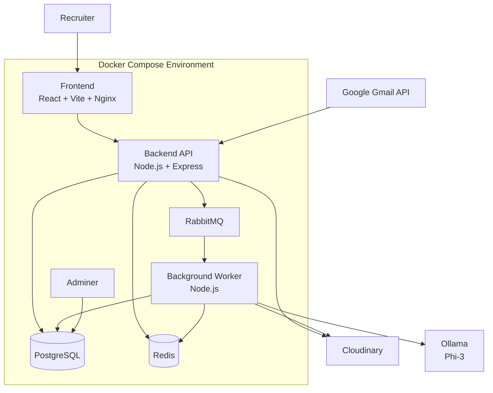
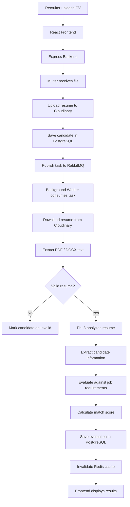
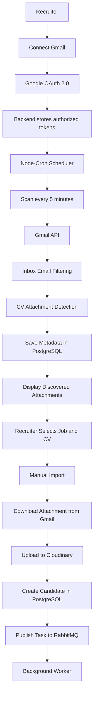
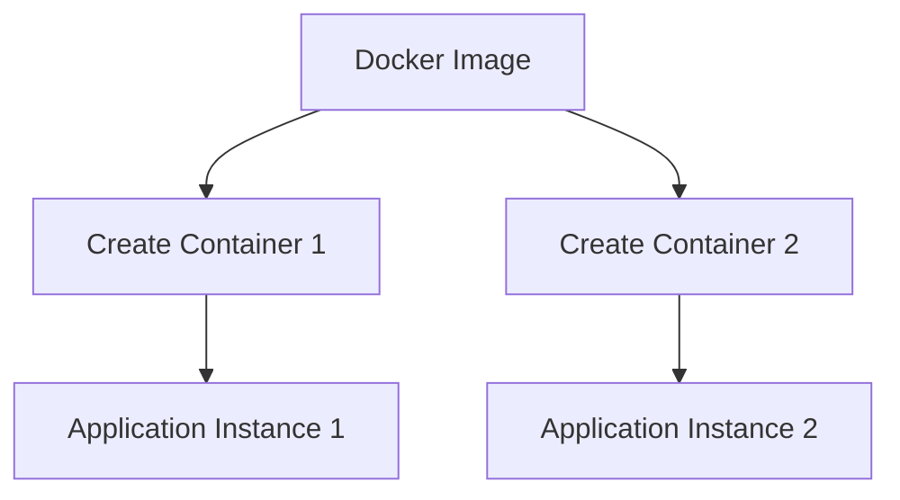
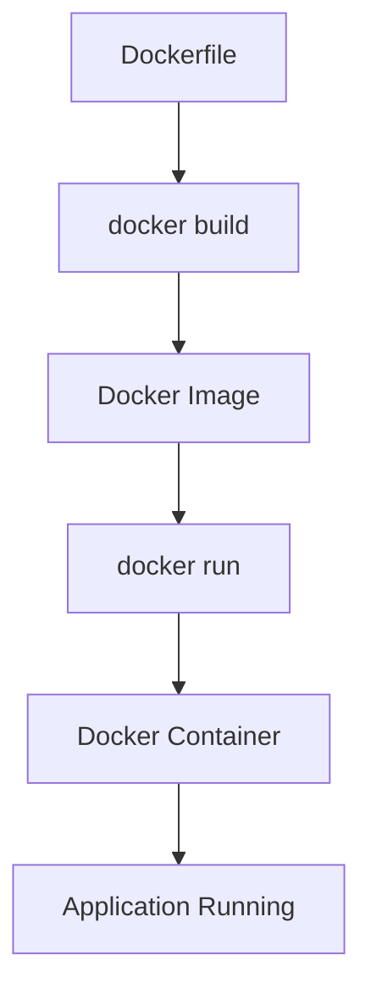
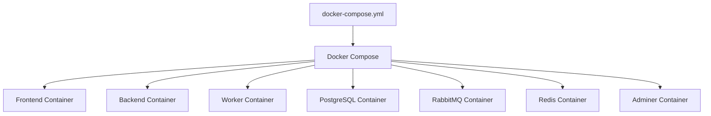
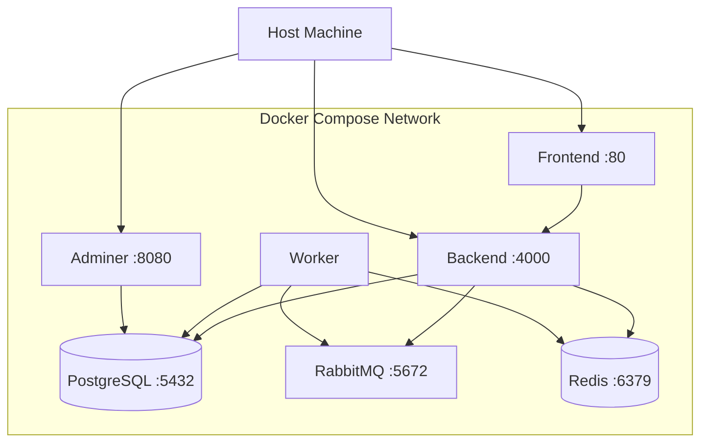

# AI-Powered CV Screening and Recruitment Management System

An AI-powered recruitment platform that automates resume screening, candidate evaluation, and recruitment management. The system uses React, Node.js, PostgreSQL, RabbitMQ, Redis, Docker, and Ollama (Phi-3) to analyze resumes and rank candidates against job requirements.

It also integrates Gmail through Google OAuth 2.0, allowing recruiters to discover and manually import CV attachments from their inbox.

---

## 1. Key Features

### Recruiter Management
- Recruiter registration and login.
- JWT-based authentication and authorization.
- Protected recruiter dashboard.

### Job Management
- Create, update, and delete job openings.
- Define mandatory and preferred skills.
- Set minimum experience requirements.
- Specify required education.

### Resume Management
- Upload PDF and DOCX resumes.
- Handle file uploads using Multer.
- Store resumes in Cloudinary.
- Extract candidate information from resumes.
- Validate uploaded documents.
- View and download original resumes.

### AI-Powered Resume Screening
- Resume analysis using Ollama (Phi-3).
- Candidate information extraction.
- Skills, education, and experience analysis.
- Compare candidate qualifications against job requirements.
- Calculate candidate match scores.
- Generate evaluation explanations.
- Rank candidates according to their match scores.

### Background Processing
- RabbitMQ message queue.
- Asynchronous resume processing.
- Background worker architecture.
- Retry mechanism for failed jobs.
- Dead Letter Queue (DLQ) for repeatedly failed jobs.

### Gmail Integration
- Google OAuth 2.0 authentication.
- Connect and disconnect Gmail accounts.
- Scan inboxes for potential CV attachments.
- Automatically discover attachments every five minutes.
- Filter potential CVs using email and filename keywords.
- Manually select a job and import relevant attachments.
- Prevent duplicate imports.

### Performance and Infrastructure
- Redis caching.
- PostgreSQL database.
- Cloudinary file storage.
- Docker containerization.
- Docker Compose orchestration.
- Adminer database management interface.

---

## 2. Technology Stack

| Technology | Purpose |
|---|---|
| React | Frontend user interface |
| Vite | Frontend development and build |
| Tailwind CSS | Frontend styling |
| Node.js | JavaScript runtime |
| Express.js | Backend REST API |
| Zustand | Frontend state management |
| Axios | HTTP requests |
| PostgreSQL | Relational database |
| RabbitMQ | Message broker |
| Redis | Caching |
| Ollama (Phi-3) | AI resume analysis |
| Multer | File upload handling |
| Cloudinary | Resume cloud storage |
| Google OAuth 2.0 | Gmail authorization |
| Gmail API | Email and attachment discovery |
| Node-Cron | Scheduled Gmail scanning |
| Docker | Containerization |
| Docker Compose | Multi-container management |
| Nginx | Production frontend server |
| Adminer | Database management |

---

## 3. System Architecture

The system consists of three main application components and four supporting infrastructure services.

### Application Components

**Frontend**
- React + Vite + Nginx
- Handles recruiter interaction and displays application data.

**Backend API**
- Node.js + Express
- Handles authentication, APIs, business logic, file uploads, and communication with other services.

**Background Worker**
- Node.js + Ollama (Phi-3)
- Processes resumes, extracts information, and evaluates candidates asynchronously.

### Infrastructure Services

- **PostgreSQL:** Stores application data.
- **RabbitMQ:** Distributes background processing tasks.
- **Redis:** Caches frequently accessed data.
- **Adminer:** Provides a graphical interface for PostgreSQL.

### External Services

- **Cloudinary:** Stores uploaded resume files.
- **Google Gmail API:** Provides authorized access to recruiter inboxes.
- **Ollama:** Runs the Phi-3 model for resume analysis.

### Complete System Architecture



**Note:** Cloudinary, Google Gmail API, and Ollama are external to the Docker Compose services in this setup. Ollama runs on the host machine and is accessed by the worker through `host.docker.internal`.

---

## 4. Project Folder Structure

```text
ai-recruitment-system/
│
├── frontend/
│   ├── src/
│   │   ├── api/
│   │   ├── components/
│   │   ├── layout/
│   │   ├── pages/
│   │   └── store/
│   ├── public/
│   ├── Dockerfile
│   ├── nginx.conf
│   ├── .dockerignore
│   └── package.json
│
├── backend/
│   └── server/
│       ├── config/
│       ├── controllers/
│       ├── lib/
│       ├── middlewares/
│       ├── models/
│       ├── routes/
│       ├── services/
│       ├── uploads/
│       ├── app.js
│       ├── Dockerfile
│       ├── .dockerignore
│       └── package.json
│
├── workers/
│   ├── src/
│   │   ├── consumers/
│   │   ├── services/
│   │   └── config/
│   ├── Dockerfile
│   ├── .dockerignore
│   └── package.json
│
├── db/
│   └── init.sql
│
├── docker-compose.yml
├── .env
└── README.md
```

---

## 5. Resume Upload and AI Processing Workflow

The resume processing workflow is asynchronous. The backend receives the resume and publishes a task to RabbitMQ. The background worker processes the resume independently of the API request.

### Workflow

1. Recruiter uploads a resume through the frontend.
2. Frontend sends the file using `FormData`.
3. Express backend receives the request.
4. Multer handles the uploaded file.
5. Backend uploads the resume to Cloudinary.
6. Candidate information and resume metadata are stored in PostgreSQL.
7. Backend publishes a processing task to RabbitMQ.
8. Background worker consumes the task.
9. Worker downloads the resume from Cloudinary.
10. Worker extracts text from the PDF or DOCX file.
11. Phi-3 validates the document.
12. Phi-3 analyzes the resume and extracts candidate information.
13. Evaluation service compares candidate qualifications against job requirements.
14. Match score and evaluation explanation are generated.
15. Results are stored in PostgreSQL.
16. Redis cache is invalidated for the affected job.
17. Frontend displays the updated candidate information and evaluation.

### Resume Processing Diagram



---

## 6. Gmail Integration Workflow

The system integrates Gmail using Google OAuth 2.0.

### Workflow

1. Recruiter clicks Connect Gmail.
2. Backend generates a secure OAuth state and authorization URL.
3. Recruiter selects a Google account and grants permissions.
4. Google redirects the recruiter to the backend callback.
5. Backend validates the OAuth state and stores the authorized tokens.
6. A Node-Cron scheduler runs every five minutes.
7. Scheduler scans connected inboxes using the Gmail API.
8. Potential CV attachments are identified using email and filename keywords.
9. Discovered attachment metadata is saved in PostgreSQL.
10. Recruiter views discovered attachments in the frontend.
11. Recruiter selects a job and clicks Import.
12. Backend downloads the selected attachment from Gmail.
13. Resume is uploaded to Cloudinary.
14. Candidate record is created in PostgreSQL.
15. Backend publishes a task to RabbitMQ.
16. Existing background worker processes the resume.

**Important:** The scheduler only discovers potential CV attachments and stores their metadata. It does not download or import the actual files automatically. The recruiter manually selects the job and imports the attachment.

### Gmail Integration Diagram



---

## 7. AI Candidate Evaluation

The system evaluates candidates based on four criteria.

| Evaluation Criteria | Weight |
|---|---:|
| Mandatory Skills | 50% |
| Preferred Skills | 20% |
| Experience | 15% |
| Education | 15% |
| **Total** | **100%** |

### Match Score Formula

The overall match score is calculated using:

\[
\text{Overall Score} =
(S_m \times 0.50) +
(S_p \times 0.20) +
(S_e \times 0.15) +
(S_d \times 0.15)
\]

Where:

- \(S_m\) = Mandatory skills score.
- \(S_p\) = Preferred skills score.
- \(S_e\) = Experience score.
- \(S_d\) = Education score.

Each criterion is normalized to a score between 0 and 100 before applying its weight.

### Recommendation Categories

| Match Score | Recommendation |
|---|---|
| 75% or above | Recommended |
| 50%–74% | Consider |
| Below 50% | Not Recommended |

The system also provides matched skills, missing skills, and explanations to help recruiters understand candidate evaluations.

---

# 8. Docker Architecture and Concepts

## 8.1 What is Docker?

Docker is a platform used to package applications and their dependencies into isolated environments called containers.

It allows applications to run consistently across different environments.

Instead of manually installing PostgreSQL, Redis, RabbitMQ, and other dependencies on the host machine, Docker allows us to run them in separate containers.

## 8.2 What is a Docker Image?

A Docker image is a read-only template or package used to create containers.

It contains:
- Application code.
- Required dependencies.
- Runtime environment.
- Configuration.
- Instructions for starting the application.

Examples in our project:

- Frontend image.
- Backend image.
- Worker image.
- PostgreSQL image.
- RabbitMQ image.
- Redis image.
- Adminer image.

## 8.3 What is a Docker Container?

A Docker container is a running instance of a Docker image.

It provides an isolated environment in which an application or service runs.

Examples:

- PostgreSQL image creates a PostgreSQL container.
- RabbitMQ image creates a RabbitMQ container.
- Backend image creates a backend container.

Each container runs its own service and can communicate with other containers through Docker networking.

## 8.4 Image vs Container

| Docker Image | Docker Container |
|---|---|
| Template or package | Instance of an image |
| Read-only | Has a writable runtime layer |
| Used to create containers | Runs the application |
| Can create multiple containers | Executes independently |

### Image and Container Diagram



**Important:** One image can be used to create multiple containers.

## 8.5 What is a Dockerfile?

A Dockerfile is a text file containing instructions for building a Docker image.

Example:

```dockerfile
FROM node:24-alpine

WORKDIR /app

COPY package*.json ./

RUN npm ci

COPY . .

EXPOSE 4000

CMD ["npm", "start"]
```

### Explanation

- `FROM`: Selects the base image.
- `WORKDIR`: Sets the working directory inside the image.
- `COPY`: Copies files into the image.
- `RUN`: Executes commands during image building.
- `EXPOSE`: Documents the application's listening port.
- `CMD`: Defines the default command when the container starts.

### Dockerfile Build Process



## 8.6 What is Docker Compose?

Docker Compose is a tool used to define and manage multiple containers through a single YAML configuration file.

Our `docker-compose.yml` defines seven services:

1. Frontend.
2. Backend.
3. Worker.
4. PostgreSQL.
5. RabbitMQ.
6. Redis.
7. Adminer.

Instead of starting every container separately, Docker Compose starts and connects all services together.

### Docker Compose Diagram



## 8.7 Docker Images and Containers in Our Project

| Service | Image | Container |
|---|---|---|
| Frontend | Custom frontend image | recruitment-frontend |
| Backend | Custom backend image | recruitment-backend |
| Worker | Custom worker image | recruitment-worker |
| PostgreSQL | postgres:17-alpine | recruitment-postgres |
| RabbitMQ | rabbitmq:4-management-alpine | recruitment-rabbitmq |
| Redis | redis:7-alpine | recruitment-redis |
| Adminer | adminer:latest | recruitment-adminer |

Docker Desktop displays images and containers separately. Each service in our Compose configuration has its own container.

## 8.8 Docker Networking

Docker Compose creates a network that allows services to communicate using their service names.

For example:

- Backend connects to PostgreSQL using `postgres`.
- Backend connects to RabbitMQ using `rabbitmq`.
- Backend connects to Redis using `redis`.
- Worker connects to RabbitMQ using `rabbitmq`.

### Docker Networking Diagram



## 8.9 Port Mapping

Port mapping connects a port on the host machine to a port inside a container.

Format:

`HOST_PORT:CONTAINER_PORT`

Example:

```yaml
ports:
  - "4000:4000"
```

This means:

- Host port: 4000.
- Container port: 4000.

### Project Ports

| Service | Host Port |
|---|---:|
| Frontend | 5173 |
| Backend | 4000 |
| PostgreSQL | 5432 |
| RabbitMQ | 5672 |
| RabbitMQ Management | 15672 |
| Redis | 6379 |
| Adminer | 8080 |

## 8.10 Docker Volumes

A Docker volume is used to persist data outside the lifecycle of a container.

For example, PostgreSQL stores database files in a Docker volume.

Example:

```yaml
volumes:
  - postgres_data:/var/lib/postgresql/data
```

Here:

- `postgres_data` is the Docker volume.
- `/var/lib/postgresql/data` is the database storage directory inside the container.

If the PostgreSQL container is removed and recreated, its data can remain available through the same volume.

---

# 9. Docker Commands

### Build and Start All Services

```powershell
docker compose up -d --build
```

Builds images if required and starts all services in the background.

### Check Running Containers

```powershell
docker compose ps
```

Displays the status of project containers.

### View All Containers

```powershell
docker ps -a
```

Displays running and stopped containers.

### View All Images

```powershell
docker images
```

Displays downloaded and built Docker images.

### View Logs

```powershell
docker compose logs -f
```

Displays logs from all services.

For a specific service:

```powershell
docker compose logs -f backend
```

### Restart a Service

```powershell
docker compose restart backend
```

### Rebuild a Specific Service

```powershell
docker compose up -d --build worker
```

### Stop All Services

```powershell
docker compose stop
```

### Stop and Remove Containers

```powershell
docker compose down
```

**Note:** Avoid `docker compose down -v` unless you intentionally want to delete associated volumes and their persistent data.

---

# 10. Dockerfile vs Docker Compose

| Dockerfile | Docker Compose |
|---|---|
| Defines how to build an image | Defines how multiple services run |
| Contains build instructions | Contains service configuration |
| Builds an application image | Starts and connects containers |
| Used by `docker build` | Used by `docker compose up` |

### Simple Explanation

- Dockerfile builds an image.
- Docker image creates a container.
- Docker Compose manages multiple containers together.

---

# 11. Implementation Roadmap

| Step | Implementation |
|---:|---|
| 1 | Frontend and backend setup |
| 2 | Frontend and backend Dockerfiles |
| 3 | Background worker setup and Dockerfile |
| 4 | Docker Compose configuration |
| 5 | PostgreSQL and Adminer integration |
| 6 | RabbitMQ integration |
| 7 | Redis integration |
| 8 | Database schema and relationships |
| 9 | Authentication and authorization |
| 10 | Job management APIs |
| 11 | CV upload and Cloudinary integration |
| 12 | RabbitMQ background processing |
| 13 | Resume extraction and validation |
| 14 | Phi-3 AI resume analysis |
| 15 | Candidate evaluation and scoring |
| 16 | Candidate ranking and dashboard |
| 17 | Gmail OAuth 2.0 integration |
| 18 | Gmail CV detection and scheduler |
| 19 | Manual Gmail CV import |
| 20 | Final testing and deployment |

---

# 12. Setup and Installation

## Prerequisites

Install the following:

- Node.js and npm.
- Docker Desktop.
- Git.
- Ollama.
- Phi-3 model.

## Step 1: Clone the Repository

```powershell
git clone <YOUR_REPOSITORY_URL>
cd ai-recruitment-system
```

## Step 2: Configure Environment Variables

Configure the required environment variables in the root, backend, and worker environment files according to the application's configuration.

Required configuration includes:

- PostgreSQL credentials.
- RabbitMQ credentials.
- Redis connection.
- JWT secret.
- Cloudinary credentials.
- Google OAuth credentials.
- Gmail redirect URL.
- Ollama base URL.

Do not commit real credentials or `.env` files to GitHub.

## Step 3: Start Ollama

On the Windows host, configure Ollama to accept connections from Docker:

```powershell
$env:OLLAMA_HOST="0.0.0.0:11434"
ollama serve
```

In another terminal, ensure the Phi-3 model is available:

```powershell
ollama pull phi3
```

## Step 4: Install Dependencies

Install dependencies in the frontend:

```powershell
cd frontend
npm install
```

Install dependencies in the backend:

```powershell
cd ../backend/server
npm install
```

Install dependencies in the worker:

```powershell
cd ../../workers
npm install
```

## Step 5: Start Docker Compose

From the project root:

```powershell
docker compose up -d --build
```

## Step 6: Verify Containers

```powershell
docker compose ps
```

Check service logs:

```powershell
docker compose logs -f
```

---

# 13. Application URLs

| Service | URL |
|---|---|
| Frontend | http://localhost:5173 |
| Backend API | http://localhost:4000 |
| Adminer | http://localhost:8080 |
| RabbitMQ Management | http://localhost:15672 |
| PostgreSQL | localhost:5432 |
| Redis | localhost:6379 |

Ollama runs on the host at `http://localhost:11434` and is accessed by the worker through `http://host.docker.internal:11434`.

---

# 14. Responsibilities of Each Technology

| Technology | Responsibility |
|---|---|
| React | Builds the frontend interface |
| Vite | Frontend development and build |
| Nginx | Serves the production frontend |
| Node.js | Runs backend and worker applications |
| Express | Handles HTTP requests and REST APIs |
| Multer | Receives uploaded files |
| Cloudinary | Stores resume files |
| RabbitMQ | Distributes background tasks |
| Worker | Processes resumes independently |
| Ollama / Phi-3 | Performs AI-based resume analysis |
| PostgreSQL | Stores permanent application data |
| Redis | Caches frequently accessed data |
| Adminer | Provides database administration |
| Docker | Packages services into containers |
| Docker Compose | Manages multiple containers |
| Gmail API | Scans authorized inboxes |
| Google OAuth 2.0 | Authorizes Gmail access |
| Node-Cron | Schedules periodic Gmail scans |

---

# 15. Important Architectural Principles

We do not perform every operation inside Express.

- **Frontend:** Handles user interaction.
- **Backend:** Handles requests, authentication, and business logic.
- **RabbitMQ:** Distributes asynchronous tasks.
- **Worker:** Performs resource-intensive resume processing.
- **PostgreSQL:** Stores permanent application data.
- **Redis:** Improves performance through caching.
- **Cloudinary:** Stores uploaded resume files.
- **Ollama:** Runs the Phi-3 AI model.
- **Docker:** Packages applications and services into containers.
- **Docker Compose:** Connects and manages all containers.

This separation makes the system modular, maintainable, and easier to scale.

---

## 16. Future Improvements

- Real-time candidate status updates using WebSockets.
- Improved resume parsing and evaluation accuracy.
- Encryption of stored OAuth tokens.
- Role-based access control improvements.
- Deployment to a cloud hosting environment.
- Automated testing and CI/CD integration.

---

## Author

**Owais Ahmed**

- GitHub: [DevOwais28](https://github.com/DevOwais28)
- Portfolio: [dev-owais-portfolio.vercel.app](https://dev-owais-portfolio.vercel.app)

**Project:** AI-Powered CV Screening and Recruitment Management System
